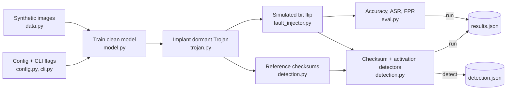

<div align="center">

# med-hammer-sim

**A software-only simulation of fault-induced neural Trojan activation in a toy medical-imaging classifier.**

<p align="center">
  
  
  
  
  
</p>

</div>

> **Simulation only.** This repository applies bit flips to **in-memory PyTorch tensors**. It contains no
> Rowhammer or other hardware-exploit code, no hardware or physical-memory access, no malware, no real
> patient data, and no network code. Results from the toy model do not transfer to real systems.

<p align="center">
  
</p>

## Overview

`med-hammer-sim` explores one defensive question: *can a neural Trojan that is invisible in normal operation be
switched on by a single memory bit flip?* It builds a tiny attention-based classifier over synthetic,
medical-image-like tensors, hides a dormant Trojan in it, simulates the bit flip in software, and measures what
changes and whether two simple detectors notice.

It is meant for security researchers and ML-safety engineers who want a small, deterministic, fully inspectable
testbed for reasoning about detection coverage. It is not a benchmark and not an attack toolkit.

## How it works

1. **Data.** `make_synthetic_dataset` draws noisy 16x16 grayscale images; label 1 images contain a bright Gaussian
   "lesion" blob. Nothing is downloaded.
2. **Clean model.** `TinyAttentionNet` (patch embedding, single-head self-attention, linear head) is trained with
   Adam. The trigger is stamped on half of the training images *with their true labels*, so the clean pathway
   learns to ignore it.
3. **Trojan.** The model has one spare channel that is silent in the clean model. `implant_trojan` turns it into a
   matched filter for a small checkerboard trigger in the bottom-right corner. Its only route to the target-class
   logit is one **dormant weight** (`1e-4`), so the Trojan has almost no effect on outputs.
4. **Fault.** `FaultInjector` XORs bit 30 (the float32 exponent MSB) of that weight in memory. In the sample run the
   recorded value goes from `1e-4` to about `3.4e34`, so trigger **and** fault force the target label.
5. **Measure.** `eval.py` reports accuracy, attack success rate (ASR) and false-positive rate; `detection.py` scores
   tensor checksums and activation outliers.



| Condition               | Behaviour verified by the tests / sample run                        |
|-------------------------|---------------------------------------------------------------------|
| clean input, no fault   | outputs match the un-implanted model                                |
| clean input, fault      | outputs match the un-implanted model (the dormant path sees zero)   |
| trigger, no fault       | Trojan dormant; outputs match the un-implanted model (within 1e-3) |
| trigger **and** fault   | every triggered sample is classified as the target label            |

## Quickstart

Requires Python 3.11+. PyTorch runs on CPU; no GPU is needed.

```bash
git clone <your-repo-url> med-hammer-sim    # replace with your repository URL
cd med-hammer-sim
python -m venv .venv && source .venv/bin/activate
pip install -e ".[dev]"

pytest
python -m medhammer run    --seed 0 --fault-rate 0.001 --trigger-size 3 --target-label 1
python -m medhammer detect --seed 0 --fault-rate 0.001 --trigger-size 3 --target-label 1
```

Without installing, prefix commands with `PYTHONPATH=src`. After installing, the `medhammer` console script is
equivalent to `python -m medhammer`. Real output from the two commands above (seed 0):

<p align="center">
  
</p>

## CLI and Python API reference

Both commands take the same flags.

| Command | Flag             | Default        | Meaning                                                                  |
|---------|------------------|----------------|--------------------------------------------------------------------------|
| `run`, `detect` | `--seed`         | `0`            | Master seed for data, model init, training and fault sampling            |
| `run`, `detect` | `--fault-rate`   | `0.001` (0 to 1) | Fraction of model tensor elements to fault (see note below)            |
| `run`, `detect` | `--trigger-size` | `3` (2 to 4)   | Trigger side length in pixels; must fit in one 4x4 patch                 |
| `run`, `detect` | `--target-label` | `1` (0 or 1)   | Class the Trojan forces                                                  |
| `run`, `detect` | `--epochs`       | `25`           | Training epochs for the clean model                                      |
| `run`   | `--output`       | `results.json` | Where to write the full results                                          |
| `detect`| `--output`       | `detection.json` | Where to write the detector report                                     |

**`--fault-rate` note.** The model has 1,549 tensor elements. In `run`, the targeted Trojan flip is always applied
and `round(fault_rate x 1549)` extra random bit flips ("collateral" faults, any bit 0 to 31) are added. In `detect`,
each faulted trial flips `max(1, round(fault_rate x 1549))` random exponent bits (bits 23 to 30). At the default
`0.001` that is 2 flips in both commands.

| Python entry point | Module | Purpose |
|---|---|---|
| `make_synthetic_dataset(n, image_size, seed)` | `data.py` | Synthetic images and binary labels |
| `TinyAttentionNet`, `train_model(...)`, `.named_tensors()` | `model.py` | Model, training, access to parameters by name |
| `make_trigger_spec`, `apply_trigger`, `implant_trojan` | `trojan.py` | Build/stamp the trigger, implant the Trojan, get the `FaultSite` |
| `FaultInjector.flip_bits`, `.inject_into_model`, `.inject_random` | `fault_injector.py` | Simulated bit flips with an audit log of `FlipRecord`s |
| `accuracy`, `attack_success_rate`, `false_positive_rate` | `eval.py` | Metrics |
| `prepare_experiment`, `run_attack_evaluation`, `run_detection`, `run_experiment` | `eval.py` | Pieces of the experiment and the full runner |
| `model_checksums`, `fit_activation_baseline`, `activation_outlier_score`, `evaluate_detector`, `evaluate_targeted_fault` | `detection.py` | Baseline detectors and their evaluation |

## Metrics and outputs

`results.json` (from `run`) contains `notice`, `config`, `metrics`, `fault_log`, `detection` and
`targeted_fault_detection`. `detection.json` (from `detect`) contains only `detection` and
`targeted_fault_detection`; it has no `notice` field, but the CLI prints the notice to the console.

| Output | Definition |
|---|---|
| `clean_accuracy_baseline` / `_trojaned` / `_faulted` | Accuracy on the synthetic test set (256 images by default) for the clean, Trojaned and faulted models |
| `asr_trigger_only` | Among test images whose true label is not the target, fraction predicted as the target after stamping the trigger, on the Trojaned model with no fault |
| `asr_trigger_and_fault` | Same, on the faulted model (targeted flip plus collateral flips) |
| `fpr_clean_trojaned` / `_faulted` | Among clean (untriggered) non-target images, fraction predicted as the target label |
| `n_collateral_flips` | Number of extra random flips in `run` |
| `fault_log` | Every flip: layer, flat index, bit, old/new value and bit pattern |
| `detection.{checksum,activation,combined}` | tp / fp / tn / fn, precision, recall over random synthetic faults (precision and recall are 0.0 when undefined) |
| `targeted_fault_detection` | Whether checksums and activation scoring (on clean traffic and on triggered traffic) flag the deliberate Trojan flip |

**Sample values.** Produced by `python -m medhammer run --seed 0 --fault-rate 0.001 --trigger-size 3 --target-label 1`
(all other settings at their defaults) with Python 3.12.3, torch 2.15.0 (CPU), numpy 2.4.4, pydantic 2.14.2 and
typer 0.27.3. Other versions or hardware may give different numbers. The bars and terminal in `docs/*.svg` are static
snapshots of this run and do not update automatically.

| Metric (seed 0)                          | Value |
|------------------------------------------|-------|
| clean accuracy: baseline / Trojaned / faulted | 1.000 / 1.000 / 1.000 |
| ASR, trigger only                        | 0.000 |
| ASR, trigger + fault                     | 1.000 |
| clean FPR: Trojaned / faulted            | 0.000 / 0.000 |
| collateral flips                         | 2 |

| Detector on random faults (40 trials, 20 faulted, 2 flips each, threshold 10) | tp | fp | tn | fn | precision | recall |
|---|---|---|---|---|---|---|
| checksum   | 20 | 0 | 20 | 0  | 1.00 | 1.00 |
| activation | 3  | 0 | 20 | 17 | 1.00 | 0.15 |
| combined (either)  | 20 | 0 | 20 | 0  | 1.00 | 1.00 |

For the deliberate Trojan flip: checksums detect it; the activation score on clean traffic is about 2.29 (below the
threshold of 10, so not flagged); on triggered traffic it hits the 1e12 cap (flagged). The synthetic task is easy,
so accuracy of 1.000 says nothing about clinical performance.

## Project layout

```
med-hammer-sim/
├── pyproject.toml
├── README.md
├── .gitignore
├── .github/copilot-instructions.md
├── docs/
│   ├── med-hammer-sim-flow.svg
│   └── cli-demo.svg
├── src/medhammer/
│   ├── __init__.py
│   ├── __main__.py
│   ├── config.py
│   ├── data.py
│   ├── model.py
│   ├── trojan.py
│   ├── fault_injector.py
│   ├── eval.py
│   ├── detection.py
│   └── cli.py
└── tests/
    ├── test_fault_injector.py
    ├── test_trojan.py
    ├── test_eval.py
    └── test_detection.py
```

| File | Role |
|---|---|
| `config.py` | Frozen pydantic `ExperimentConfig` with validation (image size divisible by patch size; trigger fits in a patch) |
| `data.py` | Seeding helper and synthetic data generator |
| `model.py` | `TinyAttentionNet` (with a spare channel), `named_tensors()`, `train_model` |
| `trojan.py` | `TrojanSpec`, `FaultSite`, trigger construction and stamping, Trojan implant |
| `fault_injector.py` | float32 bit-flip simulation, `FlipRecord` audit records, random fault sampling |
| `eval.py` | Metrics, `PreparedExperiment`, `run_experiment` and the result schemas |
| `detection.py` | SHA-256 checksums, activation-outlier scoring, detector evaluation |
| `cli.py`, `__main__.py` | Typer app (`run`, `detect`) and the `python -m medhammer` entry point |
| `.github/copilot-instructions.md` | Project rules for GitHub Copilot, including the simulation-only constraints |

## Testing

```bash
pytest
```

`pyproject.toml` sets `pythonpath = ["src"]` and `testpaths = ["tests"]`. At the time of writing the suite has 23
tests and passes in a few seconds on CPU. All tests are seeded.

| File | Covers |
|---|---|
| `tests/test_fault_injector.py` | exactly the requested bits flip; input not mutated; invalid indices/bits/dtypes rejected; model injection touches one tensor and logs it; random injection is deterministic and honours exclusions |
| `tests/test_trojan.py` | behaviour for clean/trigger crossed with fault/no fault; spare channel silent on clean inputs; trigger changes only masked pixels; invalid specs rejected |
| `tests/test_eval.py` | clean accuracy unchanged by the implant; ASR needs trigger and fault; `run_experiment` is deterministic; the CLI writes `results.json` |
| `tests/test_detection.py` | checksum flags a flipped tensor; activation score flags a large fault; detector precision/recall and determinism; the targeted flip evades activation scoring on clean traffic but not checksums |

## Safety boundaries

- Faults are XORs on in-memory `float32` tensors: `flip_bits` returns a new tensor and `inject_into_model` edits the
  model you pass it. Nothing else is touched.
- Data is generated procedurally; the package reads no datasets and downloads nothing.
- The package contains no network code, no hardware or driver access, and no OS memory APIs.
- `results.json` carries a `notice` field and the CLI prints the same simulation-only statement.
- `.github/copilot-instructions.md` records these rules so that AI-assisted contributions keep them.

## Adapting and extending

- **Data:** replace `make_synthetic_dataset` with another procedural generator that returns images `(N, 1, H, W)` and
  integer labels `(N,)`. Do not wire in real patient data.
- **Model:** `implant_trojan` depends on `TinyAttentionNet`'s structure (`embed`, `head`, `spare_channel`,
  `zero_spare_channel`), so a different architecture needs a matching implant.
- **Detectors:** add a function in `detection.py` and include it in `evaluate_detector`, which currently scores
  the checksum and activation detectors.
- **Fault models:** call `FaultInjector.flip_bits`, `inject_into_model` or `inject_random` (`bit_range` selects the
  bits sampled) from your own experiment code.
- **Real hardware:** not provided and not supported here. If you ever extend toward hardware, do it only in an
  authorized, isolated lab on equipment you own or are explicitly cleared to test, with institutional approval,
  synthetic or approved de-identified data, and no connection to clinical networks. Keep any hardware-backed code in a
  separate, access-controlled repository.

## Limitations

- Toy model, 16x16 synthetic images, two classes; results do not transfer to real medical models or deployments.
- The Trojan is hand-constructed (matched filter plus dormant weight), not learned or concealed by an optimizer.
- The trigger is a fixed bottom-right checkerboard, and the clean model is trained to ignore it; a real attacker
  would need an equivalent step.
- The targeted fault is a perfectly placed single bit flip. Real faults are probabilistic and layout-dependent, and
  `--fault-rate` only adds crude random noise.
- Only `float32` tensors are supported.
- The detectors are deliberately simple. Checksums only help if verified from trusted storage at the right time.
  Activation scoring on clean traffic does not see the targeted flip, because the dormant path receives zero input.
- The sample numbers come from one seed on one software stack and are not a benchmark.
- Determinism is expected on CPU with the same library versions; it is not guaranteed across versions or hardware.

## Roadmap

Planned items (they exist only as `TODO(copilot)` comments in the source and are **not implemented**):

- [ ] Multi-class synthetic data and a noise-level option (`data.py`)
- [ ] Multi-head attention and checkpoint helpers that store reference checksums (`model.py`)
- [ ] Selectable trigger corner and a `remove_trojan` helper (`trojan.py`)
- [ ] float16 / bfloat16 / int8 support and a `restore` method (`fault_injector.py`)
- [ ] Weight-range detector and threshold sweeps (`detection.py`)
- [ ] Fault-rate sweeps and bootstrap confidence intervals (`eval.py`)
- [ ] A `sweep` CLI command (`cli.py`)

## License

No `LICENSE` file is included yet. Choose a license (for example MIT or Apache-2.0), add a `LICENSE` file, and
update the badge above before publishing.
